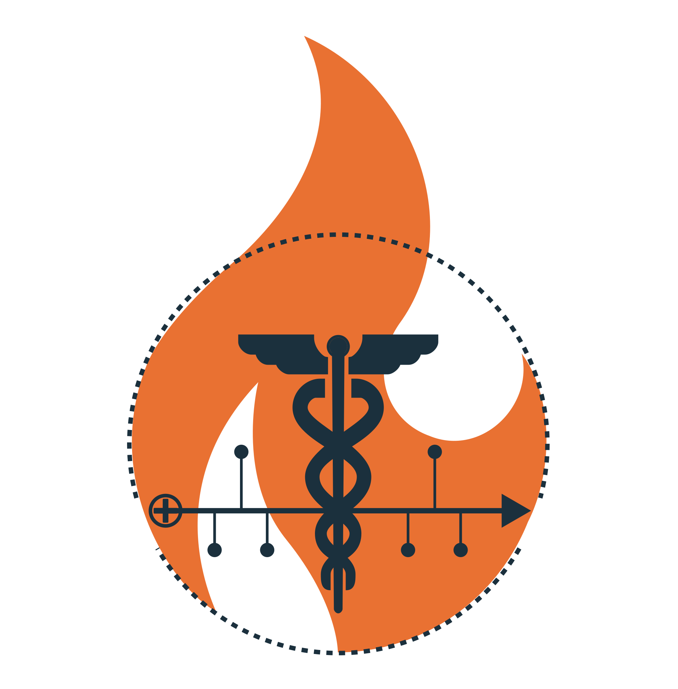

<p align="center">
  <picture>
    <source media="(prefers-color-scheme: dark)" srcset="static/meds_on_fhir_logo_light.svg">
    <source media="(prefers-color-scheme: light)" srcset="static/meds_on_fhir_logo_light.svg">
    
  </picture>
</p>

MEDS on FHIR
---

[](https://pypi.org/project/fhir2meds/)
[](https://fhir2meds.readthedocs.io/en/stable/?badge=stable)
[](https://codecov.io/gh/rvandewater/FHIR_MEDS)
[](https://github.com/rvandewater/FHIR_MEDS/actions/workflows/tests.yml)
[](https://github.com/rvandewater/FHIR_MEDS/actions/workflows/code-quality-main.yaml)

[](https://github.com/rvandewater/FHIR_MEDS#license)
[](https://github.com/rvandewater/FHIR_MEDS/pulls)
[](https://github.com/rvandewater/FHIR_MEDS/graphs/contributors)
[](https://doi.org/10.5281/zenodo.16269017)


## Overview
> [!CAUTION]
> This package is in alpha development. Use at your own risk.

**MEDS on FHIR** (`fhir2meds`) converts HL7 FHIR (R4/R5) resources into the
[MEDS](https://github.com/Medical-Event-Data-Standard/meds) format. It is tested with the MIMIC-IV FHIR demo and
with [Synthea](https://github.com/synthetichealth/synthea) synthetic data.

The pipeline has two steps:

1. **pre-MEDS** (FHIR-specific): stream FHIR resources from bulk-export NDJSON or per-patient Bundles (optionally
   gzipped), flatten them into one typed parquet table per resource type (`configs/flatten.yaml`), assign integer
   `subject_id`s, resolve `medicationReference`s and parse FHIR timestamps.
2. **MEDS-Extract** ([`meds-extract-run`](https://github.com/mmcdermott/MEDS_extract) ≥ 0.7): turn those tables
   into MEDS events according to a declarative MESSY spec (`configs/messy.yaml`), then shard by subject, split into
   train/tuning/held_out and write MEDS metadata.

Documentation, including the [design choices](https://fhir2meds.readthedocs.io/en/latest/design/) behind the
mapping and a [review of Synthea datasets](https://fhir2meds.readthedocs.io/en/latest/synthea/) for testing, is at
[fhir2meds.readthedocs.io](https://fhir2meds.readthedocs.io). Build it locally with
`pip install -e ".[docs]" && mkdocs serve`.

## Features
- Reads FHIR bulk-data NDJSON (`*.ndjson[.gz]`) and resources/Bundles (`*.json[.gz]`, e.g. Synthea output)
- Streams input, so large exports don't need to fit in memory
- Codes of the form `<ResourceType>//<VOCAB>//<code>` (e.g. `Observation//LOINC//8867-4`), with code descriptions
  taken from the FHIR `display`
- `MEDS_BIRTH`, `MEDS_DEATH` and static demographic events, Observation components, encounter start/end
- Configurable: edit `flatten.yaml` to change which FHIR elements are read, and `messy.yaml` to change the
  resulting MEDS events

---

## Installation

```bash
pip install fhir2meds
# or for local development
pip install -e ".[tests]"
```

---

## Usage

```bash
fhir2meds raw_input_dir=path/to/fhir root_output_dir=output dataset_name=MY_FHIR_DATA dataset_version=1.0
```

Output layout:

```text
output/
├── pre_MEDS/        # flat per-resource-type parquet tables, subject_id_map.parquet, effective messy.yaml
└── MEDS_cohort/     # the MEDS dataset: data/{train,tuning,held_out}/*.parquet and metadata/
```

Common options (Hydra overrides):

- `raw_input_dir`: Directory with FHIR files, searched recursively (default: `${root_output_dir}/raw_input`)
- `do_download=true do_demo=true`: download the MIMIC-IV FHIR demo (2.1.0) from PhysioNet first. Without
  `do_demo`, the credentialed MIMIC-IV FHIR release is downloaded using `PHYSIONET_USER` / `PHYSIONET_PASSWORD`
- `do_overwrite=true`: replace existing `pre_MEDS/` and `MEDS_cohort/` output
- `fhir_version=R5`: use the R5 element names in `flatten.yaml`
- `keep_local_time=true`: keep local wall-clock times instead of converting offsets to UTC
- `etl_options={n_subjects_per_shard:1000,split_fracs:{train:0.8,tuning:0.1,held_out:0.1}}`: MEDS-Extract options
- `stage_runner_fp=runner.yaml`: MEDS-Transforms stage runner config, e.g. for joblib parallelism
- `max_events=N`: only read the first N resources per type (debugging)

MEDS requires integer `subject_id`s. If a Patient has an integer identifier whose system ends in
`/identifier/patient` (MIMIC-IV's `subject_id`), it is used; otherwise the `subject_id` is a stable SHA-256-derived
integer of the Patient's logical id. The mapping is written to `pre_MEDS/subject_id_map.parquet`.

---

## Testing

```bash
pip install -e ".[tests]"
pytest
```

---

## References
- [HL7 FHIR Resource List](https://www.hl7.org/fhir/resourcelist.html)
- [MIMIC-IV FHIR Demo](https://physionet.org/content/mimic-iv-fhir-demo/2.0/)
- [MEDS Format & Schema](https://github.com/Medical-Event-Data-Standard/meds)
- [ETL_MEDS_Template](https://github.com/Medical-Event-Data-Standard/ETL_MEDS_Template)
R4 Resource List:
https://hl7.org/fhir/R4/resourcelist.html
---

## License

This project is licensed under the MIT License. See the [LICENSE](LICENSE) file for details.

---

## Contributing

Pull requests are welcome! For major changes, please open an issue first to discuss what you would like to change. 
