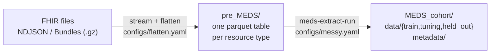

# Design choices

This page records *why* fhir2meds works the way it does. It covers the decisions most likely to matter for
downstream users of the MEDS output, together with the alternatives that were considered.

## Two stages: FHIR-specific pre-MEDS, generic MEDS-Extract

FHIR is deeply nested JSON, with choice types (`effective[x]`), references between resources and Bundles.
[MEDS-Extract](https://github.com/mmcdermott/MEDS_extract) expects *flat* tables in which each row has everything
needed to emit an event. The pipeline is split exactly at that boundary:

- **pre-MEDS** ([`pre_MEDS.py`](api.md#fhir2meds.pre_MEDS)) does everything FHIR-specific. It reads the files,
    pulls a fixed set of columns out of each resource type, and resolves links between resources.
- **MEDS-Extract** does everything MEDS-specific: building events, de-duplication, subject sharding, train/tuning/
    held_out splits, `codes.parquet`, `dataset.json` and schema-conformant output.

The earlier versions of fhir2meds wrote MEDS by hand. That code had several MEDS-compliance bugs: subjects split
across shards, unsorted shards, invalid metadata schemas, and failures swallowed silently. Delegating to the standard
tool removes that whole class of problems. It also makes the event definitions a reviewable YAML file in the same
MESSY format every other MEDS ETL uses.

## One uniform table shape

Every pre-MEDS table (except `Patient`) has the same core columns:

| column                                              | meaning                                                 |
| --------------------------------------------------- | ------------------------------------------------------- |
| `resource_type`, `resource_id`                      | FHIR type and logical id                                |
| `patient_id`, `subject_id`                          | Patient logical id, and the integer MEDS subject id     |
| `encounter_id`                                      | from `encounter` (or `context`)                         |
| `code_system`, `code_vocab`, `code`, `code_display` | the resource's primary coding                           |
| `start`, `end`                                      | parsed datetimes                                        |
| `value_num`, `value_unit`, `value_text`             | value of an Observation, or a dose/quantity             |
| `component_index`                                   | non-null for rows exploded from `Observation.component` |

Because every table has the same shape, one YAML anchor in `messy.yaml` defines the event for every resource type.
Adding a resource type is then a few lines in [`flatten.yaml`](customizing.md) plus one line in `messy.yaml`.

## Codes

Codes have the form **`<ResourceType>//<VOCAB>//<code>`**, e.g. `Observation//LOINC//8480-6`,
`Condition//ICD10CM//N179`, `MedicationRequest//RXNORM//314076`.

- **The resource type prefix** keeps the same concept recorded in different contexts apart. A SNOMED code can appear
    as a Condition, a Procedure reason or an Observation value, and an RxNorm code as a request, an administration or a
    dispense.
- **The vocabulary** comes from the coding's `system` URI through an exact-match table of standard terminologies
    ([`vocabulary.py`](api.md#fhir2meds.vocabulary)). Unknown systems fall back to the last path segment, upper-cased
    (`.../CodeSystem/d-items` → `D-ITEMS`). A heuristic is used only for MIMIC's local ICD systems, and it keeps the
    ICD version so ICD-9 and ICD-10 codes can never collide. Codings without a `system` get `UNKNOWN`.
- **Which coding:** the first coding in a CodeableConcept that has a `code` wins. Choosing a *preferred* system when
    several codings are present (e.g. RxNorm over NDC) is a possible extension.
- **Units are not part of the code.** They are kept in an extra `unit` column. This keeps the code vocabulary stable
    and leaves unit harmonisation to downstream steps. The MIMIC-IV MEDS ETL puts units *in* the code instead;
    switching is a one-line change to `messy.yaml` (`f"...//{$code}//{$value_unit ?? 'UNK'}"`).
- **Descriptions** in `metadata/codes.parquet` come from the FHIR `display` (or the CodeableConcept `text`), through
    MEDS-Extract's `_metadata: {_self: ...}` mechanism.
- **Special events:** `MEDS_BIRTH` (`Patient.birthDate`), `MEDS_DEATH` (`Patient.deceasedDateTime`), static
    `GENDER//…`, `RACE//…` and `ETHNICITY//…` (from the US Core extensions), and `Encounter_END//…` at `period.end`.

## Subject ids

MEDS requires `int64` subject ids, while FHIR Patient ids are arbitrary strings (often UUIDs). The rules are:

1. If a Patient has an **integer identifier** whose system ends with one of `subject_id_identifier_suffixes`
    (default `/identifier/patient`, which is MIMIC-IV's `subject_id`), that integer is used. MIMIC users can then join
    back to MIMIC-IV directly.
2. Otherwise the id is the first 8 bytes of **SHA-256 of the Patient logical id**, masked to a non-negative int64.

SHA-256 rather than Python's `hash()` or polars' `Expr.hash` (and therefore rather than dftly's `hash()`) is a
deliberate choice. Those hashes are not guaranteed stable across processes or library versions, and a subject id
has to be reproducible. A collision in the mapping raises an error instead of silently merging two patients. The
mapping is saved as `pre_MEDS/subject_id_map.parquet`.

Resources whose patient reference does not point to an exported Patient are dropped, and the number dropped is
logged.

## Time

- **Choice of element:** each resource type lists candidate time elements in order
    (e.g. Procedure: `performedDateTime`, then `performedPeriod.start`). The first one present is used.
- **UTC by default.** FHIR timestamps carry UTC offsets, which change across DST transitions and between sites.
    Keeping only the wall-clock time (what earlier versions did) can reorder events around DST changes and makes
    multi-site data incomparable. fhir2meds therefore converts to UTC and stores naive datetimes, as MEDS has no
    timezone. Set `keep_local_time=true` to keep local wall-clock time instead, e.g. to match the MIMIC-IV MEDS ETL,
    whose times are local.
- **Partial dates** (`YYYY`, `YYYY-MM`) are padded to the start of the period. Unparsable values become null.
- **Resources without a time.** MIMIC's `Condition` resources have no time element at all. They get their
    encounter's **end** (discharge) time (`start_fallback: encounter_end`), the usual convention for billing
    diagnoses, which are only final at discharge. Any other event whose time stays null is **dropped** by
    MEDS-Extract, not emitted as a static event, because a time-less diagnosis is not a time-invariant fact. The
    counts are logged per event in `MEDS_cohort/convert_to_MEDS_events/.logs/`.

## Linking resources

The few cross-resource links needed are resolved in pre-MEDS with polars joins, after all files have been staged.
That way the result does not depend on file order or on whether the data arrived as Bundles:

- `medicationReference` → `Medication.code` (most MIMIC MedicationRequests reference a Medication).
- `encounter` → Encounter period, for the time fallback above.
- `subject` / `patient` → Patient → `subject_id`. Relative (`Patient/x`), absolute, versioned and Bundle-internal
    (`urn:uuid:x`) references are all understood.

Practitioner, Organization and Location are ignored, because they don't describe the patient.

## Observations

`value[x]` is mapped to `numeric_value` (`valueQuantity`, `valueInteger`) or to `text_value` (`valueString`,
`valueCodeableConcept` display, `valueBoolean`, `valueDateTime`). Multi-component Observations such as blood
pressure produce one row for the panel and **one row per component**, each with its own code and value. Otherwise
the systolic and diastolic values would be lost.

## Input handling and scale

- Accepted input: `*.ndjson`, `*.ndjson.gz`, `*.json` and `*.json.gz`, searched recursively in **sorted** order, so
    runs are reproducible. Bundles are unpacked recursively. The file name doesn't matter; only `resourceType` does.
- Resources are **streamed**. They are flattened into staged parquet parts every 100k rows rather than held in memory
    as Python objects. The full MIMIC-IV FHIR demo (876 MB of NDJSON, about 760k Observations) converts in about 13 s
    with about 1 GB peak memory.
- Duplicate resources (same type and id, e.g. MIMIC ships identical `Specimen` and `SpecimenLab` files) are kept
    once. MEDS-Extract additionally collapses byte-identical event rows.
- FHIR R4 and R5 are supported through separate sections of `flatten.yaml`, since R5 renames several elements
    (`Encounter.actualPeriod`, `medication.concept`, `MedicationAdministration.occurence[x]`). Validating resources
    with `fhir.resources` is optional (`pip install fhir2meds[validation]`) and not part of the pipeline.

## Privacy

fhir2meds never writes resource *content* to stdout or logs; only file names and counts are logged. Unparsable
lines are counted, not echoed. The end-to-end tests check this by planting a sentinel string inside resources and
asserting that it never appears in the console output. This matters because the same code runs on credentialed and
non-public datasets.

## Splits and sharding

These are handled by MEDS-Extract: by default 80/10/10 train/tuning/held_out at random with a fixed seed, and 50,000
subjects per shard. Both can be changed with `etl_options={split_fracs: {...}, n_subjects_per_shard: N}`. External
splits can be provided with `external_splits_json_fp`.

## Known limitations

- MIMIC `MedicationDispense` has no time element and is dropped.
- MedicationRequests that point at a Medication without a code (MIMIC's mixtures) are dropped.
- There is no preferred-coding selection, and no extraction of Observation `referenceRange`, `interpretation` or
    `valueRange`/`valueRatio`.
- Claims, ExplanationOfBenefit, CareTeam, Goal, EpisodeOfCare and Device are not mapped by default.
