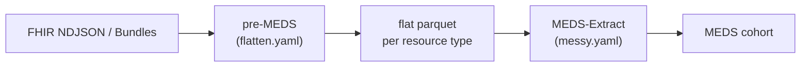

# MEDS on FHIR

{ width="160" }

**fhir2meds** converts [HL7 FHIR](https://hl7.org/fhir/) R4/R5 resources into the
[Medical Event Data Standard (MEDS)](https://medical-event-data-standard.github.io/), using
[MEDS-Extract](https://github.com/mmcdermott/MEDS_extract) for the MEDS side of the ETL.

!!! warning "Alpha"
    fhir2meds is in alpha. It is tested on the MIMIC-IV FHIR demo and on Synthea data.

## Quick start

```bash
pip install fhir2meds
fhir2meds raw_input_dir=path/to/fhir root_output_dir=output dataset_name=MY_DATA
```

The MEDS dataset is written to `output/MEDS_cohort/`. See [Usage](usage.md) for all options.

## How it works



1. **pre-MEDS** streams FHIR resources and flattens each resource type into a table. It assigns integer subject ids,
   resolves medication references, and normalizes timestamps.
2. **MEDS-Extract** builds events from those tables with a declarative spec, then shards, splits and writes MEDS
   metadata.

The reasoning behind each step is in [Design choices](design.md). To change which FHIR elements are read or which
events are produced, see [Customizing the mapping](customizing.md).

## Example output

| subject_id | time | code | numeric_value | text_value |
|---|---|---|---|---|
| 7338863945208448917 | 1971-03-01 00:00 | `MEDS_BIRTH` | | |
| 7338863945208448917 | | `GENDER//male` | | |
| 7338863945208448917 | 2020-02-03 14:00 | `Encounter//SNOMED//162673000` | | |
| 7338863945208448917 | 2020-02-03 14:05 | `Observation//LOINC//39156-5` | 27.4 | |
| 7338863945208448917 | 2020-02-03 14:15 | `Immunization//CVX//140` | | |

(Output for the Synthea-like test fixture. Times are UTC.)
