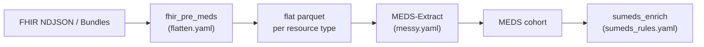

# MEDS on FHIR

{ width="160" }

**fhir2meds** converts [HL7 FHIR](https://hl7.org/fhir/) R4/R5 resources into the
[Medical Event Data Standard (MEDS)](https://medical-event-data-standard.github.io/), using
[MEDS-Extract](https://github.com/mmcdermott/MEDS_extract) for the MEDS side of the ETL and
[suMEDS](https://github.com/rvandewater/SumMEDS) for vocabulary titles and parents of the codes.

!!! warning "Alpha"
    fhir2meds is in alpha. It is tested on the MIMIC-IV FHIR demo and on Synthea data.

## Quick start

```bash
pip install fhir2meds
meds-extract-run spec=FHIR output_dir=fhir_meds do_download=false input_dir=path/to/fhir \
	"overrides=['etl_metadata.dataset_name=MY_DATA']"
```

The ETL is one [MEDS-Extract](https://github.com/mmcdermott/MEDS_extract) spec, registered as `FHIR`. The MEDS
dataset is written to `fhir_meds/` (`data/` and `metadata/`). See [Usage](usage.md) for all options.

## How it works



1. **pre-MEDS** (the `fhir_pre_meds` pre-stage) streams FHIR resources and flattens each resource type into a table. It assigns integer subject ids,
   resolves medication references, and normalizes timestamps.
2. **MEDS-Extract** builds events from those tables with a declarative spec, then shards, splits and writes MEDS
   metadata.
3. **suMEDS** adds vocabulary parents (and titles where FHIR has no `display`) to `metadata/codes.parquet`, in
   place, and records that in `metadata/dataset.json`. A failure (e.g. without internet) does not fail the run.
   `'skip_stages=[sumeds_enrich]'` skips it.

The reasoning behind each step is in [Design choices](design.md). To change which FHIR elements are read or which
events are produced, see [Customizing the mapping](customizing.md).

## Example output

| subject_id | time | code | numeric_value | text_value |
|---|---|---|---|---|
| 7338863945208448917 | 1971-03-01 00:00 | `MEDS_BIRTH` | | |
| 7338863945208448917 | | `GENDER//male` | | |
| 7338863945208448917 | 2020-02-03 14:00 | `Encounter//SNOMED//162673000` | | |
| 7338863945208448917 | 2020-02-03 14:05 | `Observation//LOINC//39156-5` | 27.4 | |
| 7338863945208448917 | 2020-02-03 14:15 | `Immunization//CVX//140` | | |

(Output for the Synthea-like test fixture. Times are UTC.)
